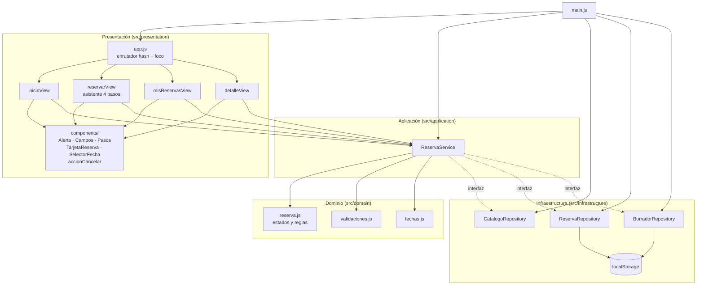
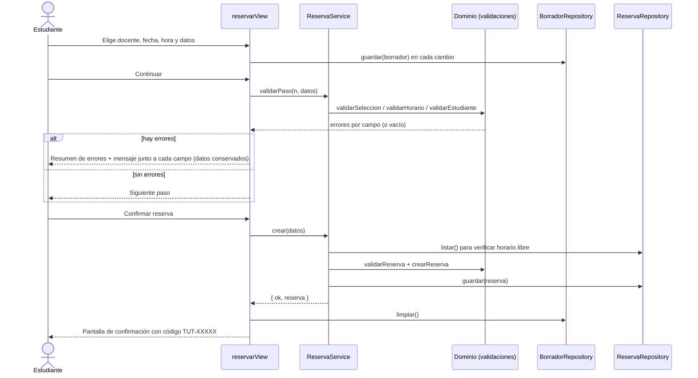
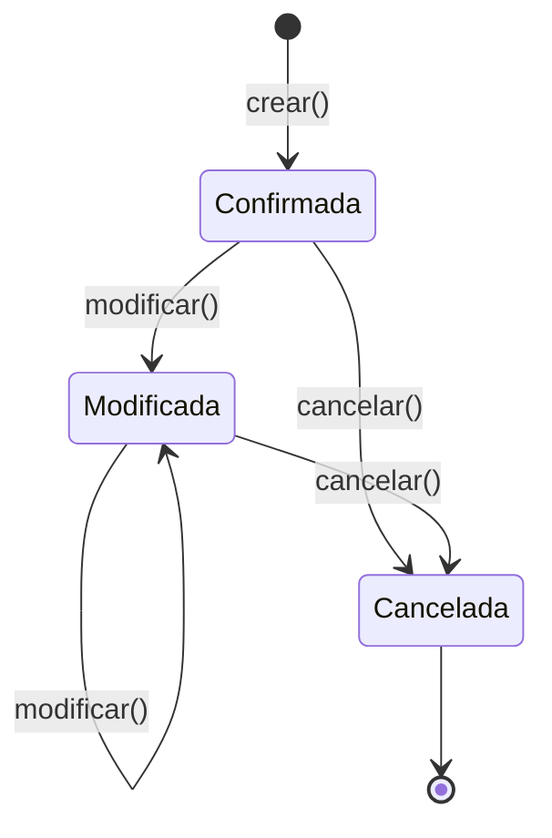

# Arquitectura de software — Tutoría UX

**Responsable:** Tomás Solis

## 1. Decisión de arquitectura

Usamos una **arquitectura por capas** inspirada en Clean Architecture, implementada con
HTML, CSS y JavaScript nativo (módulos ES). No usamos framework para que:

- cualquier integrante pueda ejecutar la app solo con Node.js (sin `npm install`);
- las capas de dominio y aplicación se puedan probar con `node --test` sin navegador;
- el HTML generado sea semántico y controlado al detalle (foco, `aria-*`, etiquetas).

| Capa | Carpeta | Responsabilidad | Depende de |
|---|---|---|---|
| Presentación | `src/presentation/` | Vistas, componentes reutilizables, enrutador, foco y anuncios accesibles | Aplicación, Dominio (solo utilidades de fecha) |
| Aplicación | `src/application/` | Casos de uso: consultar, verificar disponibilidad, registrar, modificar, cancelar, borrador | Dominio y puertos (repositorios inyectados) |
| Dominio | `src/domain/` | Entidad Reserva, estados, reglas y validaciones con mensajes claros | Nada |
| Infraestructura | `src/infrastructure/` | Catálogo de docentes y asignaturas, persistencia en `localStorage` | Nada (implementa la interfaz que espera Aplicación) |
| Composición | `src/main.js` | Crea los repositorios y el servicio y arranca la app | Todas |

La regla de dependencia va **hacia adentro**: el dominio no conoce el DOM ni el almacenamiento.
Gracias a esto, cambiar `localStorage` por una API REST solo requiere otra clase con los
mismos métodos (`listar`, `obtener`, `guardar`) en `infrastructure/`.

## 2. Diagrama de componentes

## 3. Secuencia: registrar una reserva

## 4. Estados de una reserva

Reglas: una reserva **cancelada** libera el horario y no se puede modificar; una tutoría cuya
fecha ya pasó no se puede modificar ni cancelar; el mismo docente no puede tener dos reservas
activas en la misma fecha y hora.

## 5. Componentes reutilizables

| Componente | Uso | Accesibilidad |
|---|---|---|
| `Alerta` | Éxito, error, aviso, información | `role="alert"` para errores y `role="status"` para el resto; ícono + texto (no solo color) |
| `CampoTexto`, `CampoSelect` | Todos los campos del formulario | `<label for>`, ayuda y error unidos con `aria-describedby`, `aria-invalid` |
| `GrupoOpciones` | Docentes, modalidad, horarios | `<fieldset>` + `<legend>`, radios nativos navegables con flechas |
| `ResumenErrores` | Inicio del formulario cuando hay errores | Recibe el foco; cada error es un enlace al campo |
| `Pasos` | Progreso del asistente | `aria-current="step"`, texto oculto "completado / pendiente" |
| `TarjetaReserva`, `InsigniaEstado` | Listado de reservas | Botones con texto oculto que indica la reserva ("Cancelar reserva TUT-…") |
| `SelectorFecha` | Elección de fecha | Ayuda con días de atención; límites `min`/`max` |
| `accionCancelar` | Cancelar desde listado o detalle | Mensaje de resultado que recibe el foco |

## 6. Decisiones de interacción implementadas

- **Mobile first:** el CSS base es para 360–400 px; `@media (min-width: 40rem)` y `64rem` amplían.
- **Áreas táctiles** de al menos 44 × 44 px en botones, opciones y enlaces del menú.
- **Teclado:** enlace "Saltar al contenido", orden de tabulación natural, foco visible de 3 px,
  al cambiar de pantalla el foco pasa al título (`h1`) y al cambiar de paso al `h2` del paso.
- **Conservar datos:** cada cambio se guarda como borrador en `localStorage`; volver atrás,
  corregir un error o recargar la página no borra lo elegido.
- **Errores claros:** se valida al pulsar "Continuar", se muestra un resumen con enlaces y el
  mensaje junto al campo, explicando qué pasó y cómo corregirlo.
- **Estados visibles:** insignias Confirmada / Modificada / Cancelada, horarios ocupados
  deshabilitados con el texto "Ocupado", historial de cambios en el detalle.
