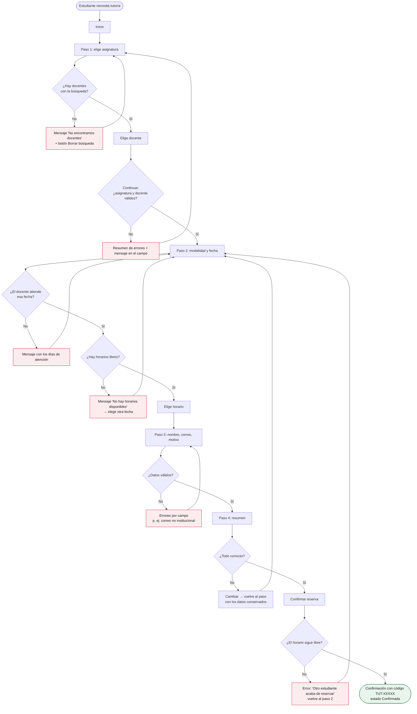
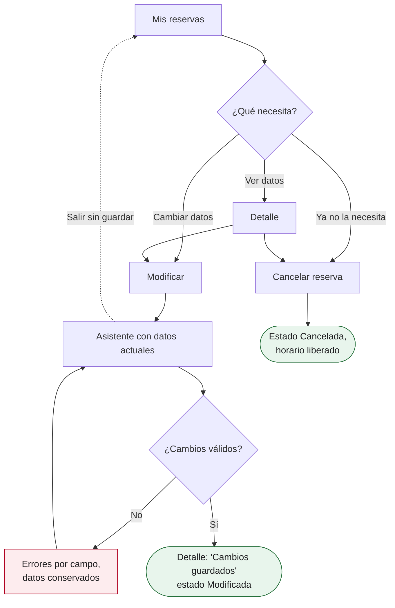

# User flow — Reservar una tutoría

**Responsable:** Bryan Guatema

Camino exitoso en verde; caminos de error y recuperación en rojo. En todos los casos de error
**los datos ya elegidos se conservan** y el foco se mueve al resumen de errores.

## Flujo: modificar o cancelar

## Tabla de recuperación de errores

| Error | Dónde | Mensaje mostrado | Cómo se recupera |
|---|---|---|---|
| Sin asignatura o docente | Paso 1 | "Elige la asignatura en la que necesitas ayuda." | Enlace del resumen lleva al campo |
| Búsqueda sin resultados | Paso 1 | "No encontramos docentes con esa búsqueda" | Botón "Borrar búsqueda" |
| Día sin atención | Paso 2 | "El docente no atiende ese día. Atiende los lunes y miércoles." | Elegir otra fecha |
| Fecha pasada / muy lejana | Paso 2 | "La fecha ya pasó…" / "…máximo de 30 días…" | Elegir otra fecha (el calendario ya limita) |
| Correo no institucional | Paso 3 | "Usa tu correo institucional, por ejemplo: nombre1234@uta.edu.ec" | Corregir el campo; los demás datos siguen escritos |
| Horario tomado al confirmar | Paso 4 | "Otro estudiante acaba de reservar ese horario. Elige otro disponible." | Vuelve al paso 2 con lo demás conservado |
| Recarga accidental | Cualquiera | "Recuperamos tu reserva sin terminar" | Continúa donde la dejó o "Empezar de nuevo" |
