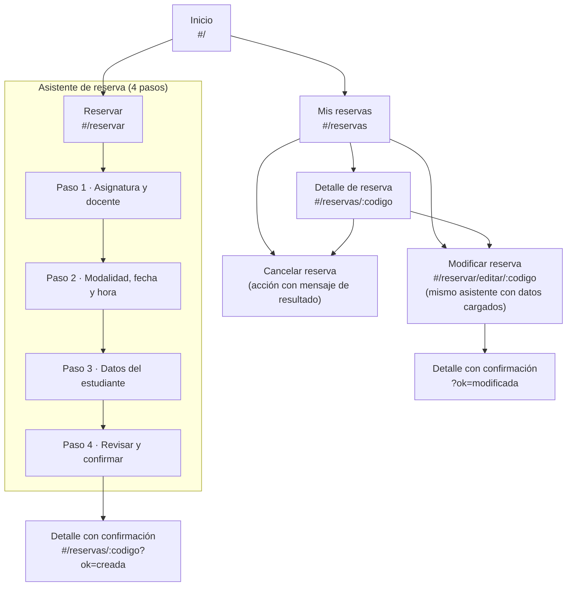

# Sitemap — Tutoría UX

**Responsable:** Bryan Guatema

La navegación principal tiene tres entradas siempre visibles (Inicio, Reservar, Mis reservas).
El proceso de reserva es un asistente lineal de 4 pasos con retorno libre a pasos anteriores.

## Inventario de pantallas

| Código | Pantalla | Ruta | Contenido principal |
|---|---|---|---|
| P-01 | Inicio | `#/` | Qué hace el sistema, botón "Reservar una tutoría", acceso a "Mis reservas", aviso de reserva sin terminar |
| P-02 | Reservar · paso 1 | `#/reservar` | Selector de asignatura, búsqueda, lista de docentes |
| P-03 | Reservar · paso 2 | `#/reservar` | Modalidad, fecha, horarios disponibles/ocupados |
| P-04 | Reservar · paso 3 | `#/reservar` | Nombre, correo institucional, motivo |
| P-05 | Reservar · paso 4 | `#/reservar` | Resumen con "Cambiar" por dato, confirmar |
| P-06 | Detalle / confirmación | `#/reservas/:codigo` | Código, estado, datos, lugar, historial, modificar/cancelar |
| P-07 | Mis reservas | `#/reservas` | Filtro por estado, tarjetas de reservas, nueva reserva |
| P-08 | Modificar reserva | `#/reservar/editar/:codigo` | Asistente con datos actuales precargados |
| P-09 | No encontrado | cualquier otra | Mensaje y enlace al inicio |

## Etiquetas de navegación

Se usan verbos y sustantivos del vocabulario del estudiante ("Reservar", "Mis reservas",
"Modificar", "Cancelar reserva") en lugar de términos técnicos ("Gestión", "CRUD", "Agenda").
