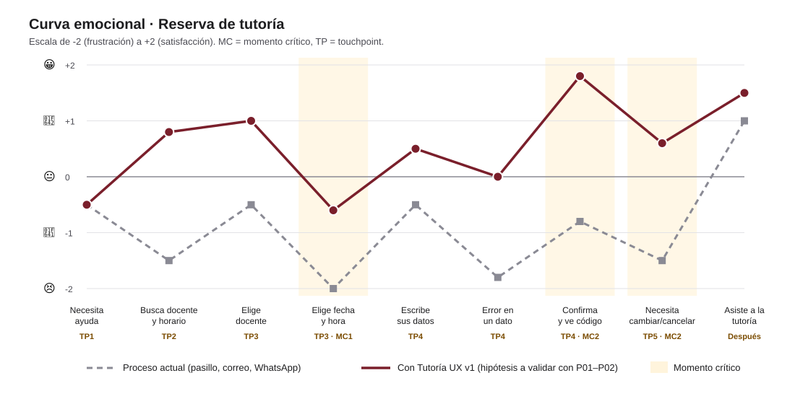

# Curva emocional del proceso de reserva

**Responsable:** Karen Molina

La curva compara cómo se siente el estudiante en cada etapa con el **proceso actual** (pasillo,
correo, WhatsApp) y con **Tutoría UX v1**. La curva de v1 es una **hipótesis de diseño**; se
contrasta con lo observado en P01 y P02 (comentarios en voz alta y SEQ por tarea) en
[`evaluacion/resultados.md`](../evaluacion/resultados.md).

| # | Etapa | Touchpoint | Emoción actual | Emoción con v1 | Por qué |
|---|---|---|---|---|---|
| 1 | Necesita ayuda | TP1 | -0,5 | -0,5 | Preocupación por la evaluación; el sistema todavía no interviene |
| 2 | Busca docente y horario | TP2 | -1,5 | +0,8 | Hoy pregunta a compañeros o escribe sin respuesta; con v1 ve a todos los docentes de la asignatura |
| 3 | Elige docente | TP3 | -0,5 | +1,0 | Las tarjetas muestran modalidad y días para decidir |
| 4 | **Elige fecha y hora** | TP3 · **MC1** | **-2,0** | **-0,6** | Punto más bajo: no sabe qué días atiende; en v1 todavía puede elegir un día sin atención y debe probar otra fecha |
| 5 | Escribe sus datos | TP4 | -0,5 | +0,5 | Solo tres campos con ayuda |
| 6 | Error en un dato | TP4 | -1,8 | 0,0 | Hoy un correo mal escrito significa que no le responden; en v1 el error se explica junto al campo y no se borra nada |
| 7 | **Confirma y ve su código** | TP4 · **MC2** | -0,8 | **+1,8** | Punto más alto: certeza inmediata con código y estado |
| 8 | **Necesita cambiar o cancelar** | TP5 · **MC2** | -1,5 | +0,6 | Hoy debe volver a escribir al docente; en v1 lo hace solo, pero cancelar no pide confirmación (riesgo de error) |
| 9 | Asiste a la tutoría | Después | +1,0 | +1,5 | Llega sabiendo hora y lugar |

## Lectura de la curva

- Los dos valles de v1 coinciden con los **momentos críticos**: elegir fecha (MC1) y la
  cancelación sin confirmación dentro de "cambiar o cancelar" (MC2).
- Esos dos puntos se convirtieron en las oportunidades **O1** y **O2** de
  [`touchpoints.md`](touchpoints.md) y en los hallazgos priorizados para v2.
- Meta de v2: que ninguna etapa del proceso quede por debajo de 0.
