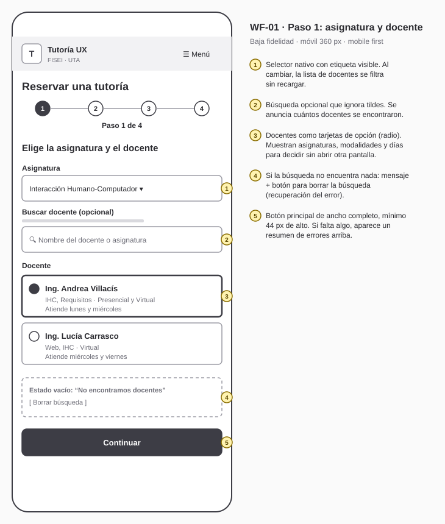
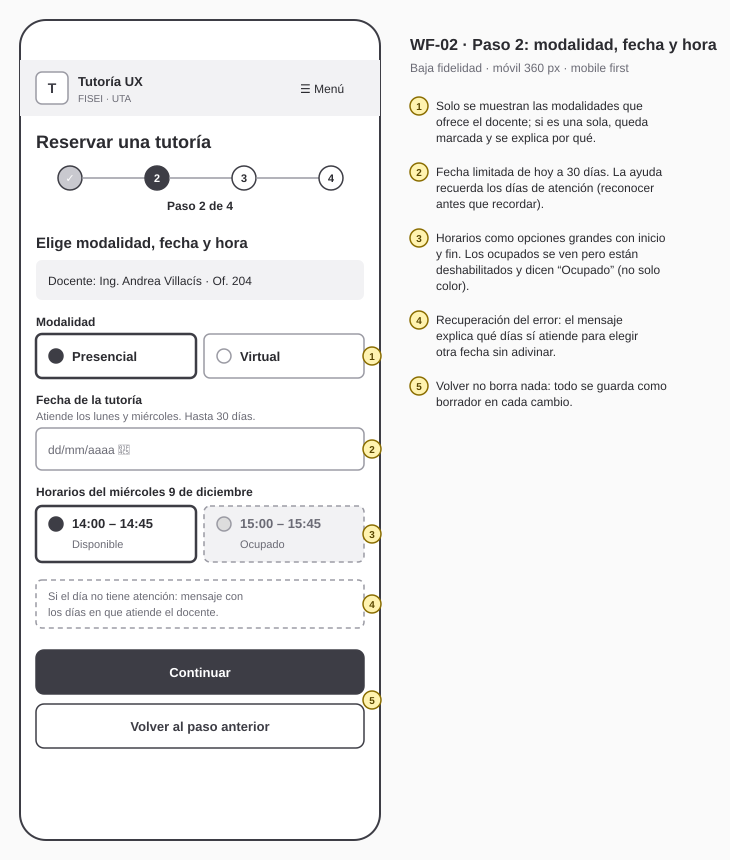
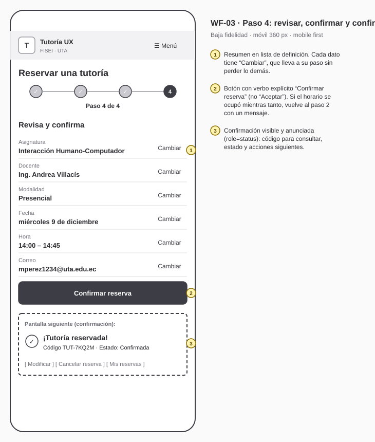

# Wireframes — Tutoría UX

**Responsable:** Bryan Guatema

Tres wireframes de **baja fidelidad**, diseñados primero para móvil (360 px) siguiendo el enfoque
mobile first. Cada uno tiene anotaciones numeradas que explican las decisiones de interacción.

| Código | Pantalla | Requisitos | Archivo |
|---|---|---|---|
| WF-01 | Paso 1: asignatura y docente (incluye estado vacío de búsqueda) | R1 | [wf-01-seleccion-docente.svg](wf-01-seleccion-docente.svg) |
| WF-02 | Paso 2: modalidad, fecha y hora (incluye horario ocupado y día sin atención) | R2 | [wf-02-fecha-horario.svg](wf-02-fecha-horario.svg) |
| WF-03 | Paso 4: resumen con "Cambiar" y pantalla de confirmación | R3, R5 | [wf-03-resumen-confirmacion.svg](wf-03-resumen-confirmacion.svg) |

## Decisiones comunes

- Un solo objetivo por pantalla y un botón principal de ancho completo.
- Indicador de progreso "Paso N de 4" para que el estudiante sepa cuánto falta.
- Opciones grandes (radio) en lugar de listas desplegables cuando hay pocas alternativas
  (docentes, modalidad, horarios): se comparan de un vistazo y son fáciles de tocar.
- Los estados (ocupado, error, vacío) se comunican con texto y forma, no solo con color.
- Todo paso permite volver sin perder lo elegido.
